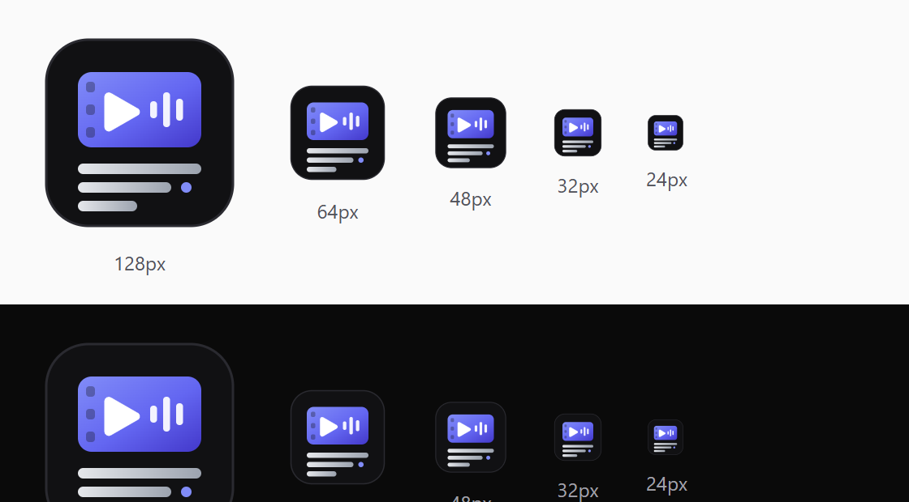

<p align="center">
  
</p>

<h1 align="center">youtube-transcript-skill</h1>

<p align="center">
  <b>A Claude Skill that actually watches a video.</b><br>
  Frames, audio and a timestamped transcript — from YouTube or any local file.<br>
  Local transcription with Whisper. Nothing is sent anywhere.
</p>

<p align="center">
  
</p>

---

> **Note on language.** The skill itself is written in **Spanish** — it was built for a
> Spanish-speaking team. Claude reads and applies it in any language: ask in English, get English
> back. This README is bilingual; everything else is Spanish. The script's `--help` is Spanish too.
>
> **Nota sobre el idioma.** La skill está escrita **en español**. Este README es bilingüe (inglés
> primero, para que se encuentre); el resto del repositorio está en español.

---

# English

## What it is

A [Claude Skill](https://docs.claude.com/en/docs/claude-code/skills) that turns a video into
something an agent can genuinely read: **extracted frames, the audio, and a transcript with
timestamps**. It follows the [Agent Skills](https://agentskills.io/) open format, so it also works
in other tools that implement it.

**The rule it exists to enforce:** a video isn't watched until you've read the transcript **and**
looked at the frames. Whatever is written on screen and never said out loud — a number, a caption,
an edit — is not in the text, and it is usually the thing you were asked to look at.

## One command

```bash
python scripts/ver_video.py "https://www.youtube.com/watch?v=..." --salida ./visto
python scripts/ver_video.py ./lecture.mp4 --salida ./visto --fotogramas 40
```

You get `transcripcion.txt` (timestamped), `fotogramas/` and `video.json`.

## What makes it different from "just call yt-dlp"

Every number below was **measured, not assumed** — on 2026-10-19, against a real video.

- **A fallback ladder for the transcript, because the obvious path breaks.**
  `yt-dlp --write-auto-sub` returns **`HTTP 429 Too Many Requests`** very often, and retrying
  doesn't help. The skill falls back to **local Whisper** (`faster-whisper`), and tells you
  exactly what's left to try when both fail — instead of inventing a summary from the title.
- **Frames without downloading the video.** YouTube already ships storyboard grids (`-f sb0`).
  For a 12-minute video that's **17 grids of 960×540 — 153 frames in 597 KB**, roughly one frame
  every 4.7 s. No hundreds of megabytes, and it survives the `403 Forbidden` that the video
  download sometimes returns.
- **The traps, written down with the exact error text.** The `.mhtml` storyboard file is
  **binary** — parsing it as text silently produces JPEGs that start with a literal `\uff` and
  that `ffprobe` rejects. Windows' cp1252 console throws `UnicodeEncodeError` on an arrow and
  kills the run. A fixed scene-detection threshold of `0.30` reported **1 cut where there were
  14**, because jump cuts on a static background score 0.15–0.30.
- **Local and private.** Whisper runs on your machine. Measured on CPU with no GPU, model `small`
  at `int8`: **3.4 s to load, 20 s of audio in 9.4 s** — about 2× realtime, so a 12-minute video
  costs ~6 minutes of CPU.

## Requirements

| | For what | If missing |
|---|---|---|
| **yt-dlp** | fetching from YouTube and friends | `pip install -U yt-dlp` — keep it updated, YouTube changes |
| **ffmpeg** / **ffprobe** | audio and frames | [ffmpeg.org](https://ffmpeg.org/download.html) |
| **faster-whisper** | local transcription | `pip install faster-whisper` *(optional)* |
| **scenedetect** | edit-cut detection | `pipx install "scenedetect[opencv]"` *(optional)* |

## Install

**Claude Code — for every project:**

```bash
git clone https://github.com/w-avw/youtube-transcript-skill.git ~/.claude/skills/youtube-transcript-skill
```

**Claude Code — one project only:**

```bash
git clone https://github.com/w-avw/youtube-transcript-skill.git .claude/skills/youtube-transcript-skill
```

**Claude Desktop / claude.ai:** Settings → Capabilities → enable code execution, then Customize →
Skills → **+** → *Upload a skill*, with a zip whose inner folder is named
`youtube-transcript-skill`.

## When Claude uses it

Ask any of these and it loads on its own: *"watch this video"*, *"transcribe this"*, *"what does
this video say"*, *"summarise this YouTube video"*, *"pull the frames"*, *"analyse this reel"*,
*"how many cuts does this edit have"*.

## What it does NOT do

No translation (transcribes in the original language on purpose), no speaker diarization, no
summarising on your behalf — it leaves the material so **you** can look. And it downloads only
what's needed to watch: respect each platform's terms and copyright.

## License

MIT. See [LICENSE](LICENSE).

---

# Español

## Qué es

Una [Claude Skill](https://docs.claude.com/en/docs/claude-code/skills) para **mirar un vídeo de
verdad**: fotogramas, audio y transcripción con marcas de tiempo, de YouTube o de un fichero tuyo.

**La regla de la que cuelga todo:** un vídeo no está mirado hasta que has leído la transcripción
**y** visto los fotogramas. Lo que sale escrito en pantalla y no se dice en voz alta no está en el
texto — y suele ser justo lo que te pidieron mirar.

## Un comando

```bash
python scripts/ver_video.py "https://www.youtube.com/watch?v=..." --salida ./visto
python scripts/ver_video.py ./clase.mp4 --salida ./visto --fotogramas 40
```

Deja `transcripcion.txt` (con marcas de tiempo), `fotogramas/` y `video.json`.

## Qué tiene que no tenga «llamar a yt-dlp»

Todas las cifras están **medidas**, no supuestas (19/10/2026, sobre un vídeo real):

- **Una escalera de caminos para la transcripción, porque el obvio se rompe.**
  `yt-dlp --write-auto-sub` devuelve **`HTTP 429`** a menudo y reintentar no sirve. Se cae a
  **Whisper en local**, y si tampoco se puede **lo dice y enumera qué queda por probar** — en vez
  de inventarse un resumen a partir del título.
- **Fotogramas sin descargar el vídeo:** el guion gráfico de YouTube (`-f sb0`). Para 12 minutos,
  **17 rejillas de 960×540 — 153 fotogramas en 597 KB**, uno cada ~4,7 s. Y sobrevive al `403` que
  a veces devuelve la descarga del vídeo.
- **Las trampas, con su mensaje de error exacto:** el `.mhtml` es **binario** y leerlo como texto
  da JPEGs corruptos que empiezan por `\uff`; la consola de Windows revienta con
  `UnicodeEncodeError` al imprimir una flecha; y un umbral de escena fijo de `0,30` contó **1
  corte donde había 14**.
- **En local y privado.** Medido en CPU sin GPU, modelo `small` en `int8`: **3,4 s de carga y 20 s
  de audio en 9,4 s** (unas 2 veces el tiempo real). Un vídeo de 12 minutos, ~6 minutos de CPU.

## Instalar

```bash
# para todos tus proyectos
git clone https://github.com/w-avw/youtube-transcript-skill.git ~/.claude/skills/youtube-transcript-skill

# solo para este
git clone https://github.com/w-avw/youtube-transcript-skill.git .claude/skills/youtube-transcript-skill
```

## Qué NO hace

No traduce, no separa hablantes, y no resume por ti: deja el material para que **tú** lo mires.
Descarga lo mínimo para poder verlo — respeta los términos de cada plataforma y los derechos de
autor.

## Licencia

MIT. Ver [LICENSE](LICENSE).
